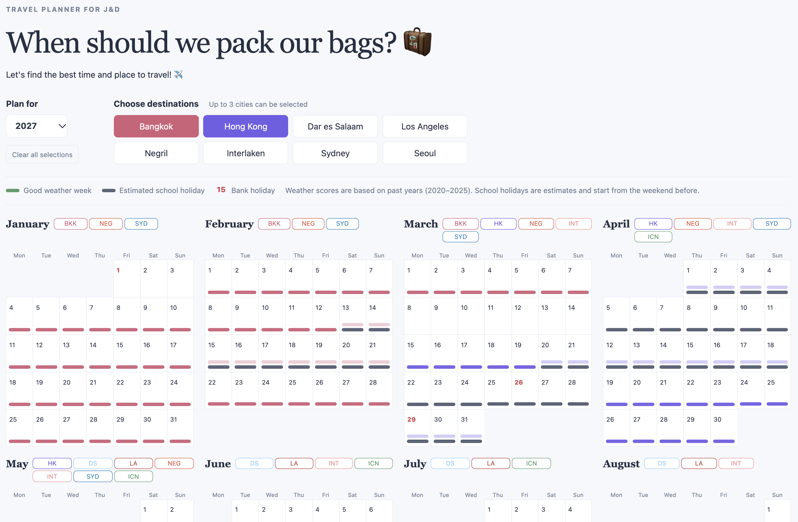

# [Travel Planner Pipeline](https://day-lee.github.io/travel-planner-pipeline/)
A project to collect travel weather and UK bank holiday data, transforming it through structured SQL layers to support travel destination decision-making.
<p align="center">
  <a href="https://day-lee.github.io/travel-planner-pipeline/">
    
  </a>
  <br>
  <a href="https://day-lee.github.io/travel-planner-pipeline/">Open the live dashboard</a>
</p>
## The builder
Hi, I am Dayeon.
I'm based in London, where I moved three years ago after marrying my British husband.

- I studied business administration, then worked in tech sales at Apple and digital marketing for Chanel.
- I moved into software engineering after using Python to automate repetitive data collection and reporting tasks in digital marketing.
- I spent two and a half years as a software engineer at an EdTech company in Seoul, where the work I enjoyed most was data: tuning slow queries and designing event data models.
- I lead an accountability group of four. We meet weekly to share progress and work through blockers on our side projects and engineering careers.
- I regularly attend community events, such as Codebar workshops and the Snowflake World Tour, to keep learning.


## Why I'm applying to be a data engineering consultant
- Data engineering brings together the two sides of my background, business and engineering. What I enjoy most is getting messy data into shape so it can drive actionable business insights. That's why I spent this summer learning dbt by building a pipeline that turns 81,000 messy [London food hygiene records into a business-ready dataset](https://github.com/day-lee/london-restaurant-hygiene-pipeline).
- In every role I've had, I've worked closely with clients and stakeholders, from customers at Apple to external engineers at Udemy and Coursera. Through this, I've learned to adapt quickly to new people and build trust through clear communication, which I believe will help me thrive as a consultant at The Information Lab. 
- More of my work is in my [portfolio](https://portfolio-2025-rho-rouge.vercel.app/).

## What I built and who it's for
<p align="center">
  
  
    <br>
  <em>Photos from a holiday in Sicily, October 2026</em>
</p>

- My partner and I love travelling, and we need to plan ahead to fit trips around our busy schedules, considering the weather at each destination and UK school holidays.
- This dashboard helps us make the first decision at a glance: where to go, and when.

It uses two indicators:
- **Destination weather** – comfortable 'feels-like' temperature, low rainfall and no strong wind.
- **UK school holidays** – weeks that overlap school holidays are usually more crowded, and flights cost more, so the calendar flags them.


## The data
- **[Open-Meteo Weather API](https://open-meteo.com/en/docs)** – daily apparent temperature, rainfall and wind for each city since 2020.
- **[GOV.UK bank holidays API](https://www.gov.uk/bank-holidays.json)** – this only provides bank holidays, so I estimate school holidays from the bank holidays.


## How it works

`run_pipeline.py` runs the whole pipeline in one command:

1. Extract: Python scripts call the Open-Meteo and GOV.UK bank holidays APIs and save the raw JSON responses.
2. Load and transform: the SQL models in `sql/` build `travel_planner_warehouse.duckdb` in layers: seed → staging → marts.
3. Export: `build_site.py` writes the marts to JSON, and the dashboard (HTML, CSS and JavaScript) reads only that JSON.

`tests/test_models.py` runs smoke tests on the finished tables: nothing missing, no duplicate rows, and no implausible values.

The pipeline is idempotent: each run deletes the database and rebuilds every table with `CREATE OR REPLACE`, so running it twice gives the same result. Raw files pile up as new data is fetched(potentially yearly), so each staging model reads only the most recent file, per city for weather, to avoid duplicate rows.


1. `0_seed/dim_cities_weather_thresholds.sql`
one row per city, loaded from the hand-written `cities_weather_thresholds.json`. The table is defined before loading so that constraints catch mistakes in the JSON: `PRIMARY KEY` and `NOT NULL`, plus `CHECK`s that the minimum value is below the maximum. A bad value makes the `INSERT` fail, so it never reaches the weather scores.


2. `1_stg/stg_bank_holidays.sql` one row per bank holiday in England and Wales, where the target user lives. Each fetch saves a file named after that year (e.g. `2026.json`). The model reads only the most recent file. 


3. `1_stg/stg_weather.sql` one row per city per day. `city_id` and the `end_date` come from the file name using regex (e.g. `BKK_2020-01-01_2025-12-31.json`). Each new year adds a file per city, so the model keeps only the latest file for each city (`ROW_NUMBER() ... QUALIFY ... = 1`), then unnests the daily arrays and fixes the types (DATE, DOUBLE).


4. `2_marts/dim_uk_school_holidays_estimate.sql`  one row per school holiday period, six per year. There is no national dataset of school term dates, so the periods are estimated from rules, all listed in the SQL header comment.
In summary:
* Anchors: Good Friday, Easter Monday and the spring bank holiday move every year, so they come from `stg_bank_holidays`. The other holidays use fixed dates based on council calendar patterns, e.g. the week containing 28 Oct for October half-term.
* Easter: schools follow either early April or Easter itself, so the period covers both (`LEAST`/`GREATEST`), capped at three weeks.
* Saturday to Sunday: each period starts on the Saturday before, because that's when holiday travel demand starts.
* Wide on purpose: flagging an extra week costs the user less than missing a holiday week.
* Limits: sample checked against 10 council calendars (2022–2026). Easter and May half-term matched every council checked; February half-term matched least often (76%)


5. `2_marts/mart_weekly_weather_score.sql`

One row per city per week of the year (weeks 1–52). It is built in three steps: score each day against the city's weather thresholds, count the good days in each week of each year, then combine the years into a typical week.

* `is_good_day`: the apparent temperature, rain and wind are all within that city's thresholds.
* `good_day_share`: good days divides by `days with data`, pooled across 2020–2025. 
`is_good_weather`: the business rule is `good_day_share >= 0.6`, i.e. good weather on about 4 of 7 days on average. It describes past years, not a forecast.
* Week 53 is dropped: it appears in only one year of the data, so its score would rest on a single year.


6. Dashboard: `build_site.py` reads the marts and writes `site_data.json`, turning week numbers into real dates for each year. The page is plain HTML, CSS and JavaScript, and `app.js` only reads that JSON and draws the calendar. Decisions stay in the SQL models (`is_good_weather`).


## How to run it 
```
git clone https://github.com/day-lee/travel-planner-pipeline
cd travel-planner-pipeline
python3 -m venv .venv && source .venv/bin/activate
pip install -r requirements.txt

# fetch the API data, build the warehouse and verify data quality
(Data quality checks for missing values, duplicates, and implausible values)
python run_pipeline.py --fetch && pytest tests/test_models.py

# run dashboard 
.venv/bin/python build_site.py
python -m http.server 8000 --directory dashboard
# open dashboard  http://localhost:8000

# (optional) Open the DuckDB web UI to browse the tables
duckdb -ui travel_planner_warehouse.duckdb
```


## What I would do next
- **Shared HTTP client** – move the fetch logic repeated in `api_uk_holidays.py` and `api_weather.py` into one client with consistent timeouts, retries and error handling.
- **dbt** – move the SQL layers into dbt: `ref()` for run order instead of numbered folders and declared tests for each table's grain.
- **Dynamic cities on demand** – Instantly add any city to automatically fetch weather data and calculate specific thresholds. While originally built for my partner and me, this dynamic scalability makes the tool beneficial for a much broader user base.
- **Real school term dates** – scrape term dates from council websites to replace the rule-based estimates, or at least measure their accuracy.


## Where AI helped 
I led the direction and the decisions, and Claude wrote the code.

- **Topic and data**: I chose the pipeline topic and focused on tightly scoped target users for the MVP. Claude suggested candidate APIs, and I picked the weather parameters after checking real responses. I chose apparent temperature over measured temperature, because what matters on holiday is how comfortable it actually feels.
- **Weather thresholds**: I started from Claude's draft and tuned the values by running queries myself. I tested them on Seoul first, where I have lived, and checked that the good weeks matched my own experience and online travel guides.
- **School holidays**: Claude wrote the rules that estimate the holiday dates; my job was to check them. I asked Claude to compare the estimates against past term dates from 10 councils, then opened some of the cited sources myself. Doing so showed that council pages remove past years' dates, so I treated it as a sample check rather than an accuracy measure and documented that limit.
- **Data quality check**: I set three categories for data validation: missing/blank values, duplicate records, and implausible values. I manually introduced corrupted data inputs to verify the reliability of the test suite.
- **Code review**: I read Claude's code line by line and questioned anything I couldn't explain. For example, I merged two date functions into one and confirmed the output hadn't changed. I also kept only one of the two weather scores Claude suggested, one metric I can explain clearly is better than two I can't.
